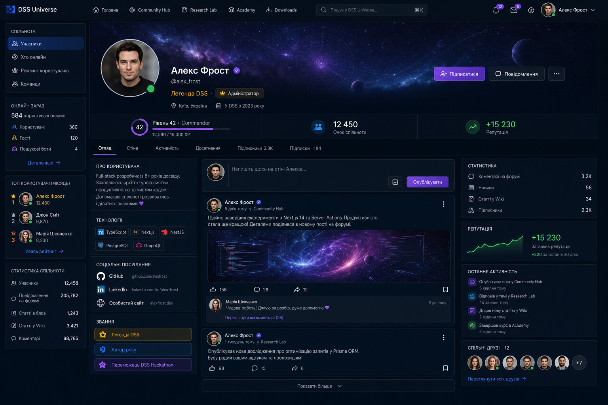

<p align="center">
  <strong>DSS UNIVERSE</strong>
</p>

<h1 align="center">DSS Universe</h1>

<p align="center">
  <strong>Build. Inspire. Grow.</strong><br>
  The community behind great software.
</p>

<p align="center">
  A modular developer platform bringing people, technical knowledge, learning,<br>
  content, media, and intelligent assistance into one connected community.
</p>

<p align="center">
  
  
  
  
  <a href="LICENSE"></a>
</p>

<p align="center">
  <a href="#explore-the-universe">Modules</a> ·
  <a href="#design-preview">Design preview</a> ·
  <a href="#architecture">Architecture</a> ·
  <a href="#getting-started">Getting started</a> ·
  <a href="#project-status">Status</a> ·
  <a href="#documentation">Documentation</a>
</p>

---

## One universe. Many ways to grow.

DSS Universe is being built as a community-centered platform for software developers. Instead of scattering discussions, technical writing, resources, and learning across disconnected experiences, the project aims to give them a shared home.

**The community comes first.** The technology exists to help people share ideas, contribute, learn, and build useful software together.

| **Connect** | **Learn** | **Create** | **Grow** |
| :--- | :--- | :--- | :--- |
| Meet developers and join conversations. | Explore technical writing and structured learning. | Publish knowledge and share resources. | Follow contributions, progress, and achievements. |

> [!IMPORTANT]
> **DSS Universe is under active development, not a released product.** The mockups below communicate the approved visual direction; they are not proof that every illustrated screen or feature is implemented.

## Explore the Universe

The platform is organized into connected product areas, each with clear responsibilities.

| Area | Purpose |
| :--- | :--- |
| **Mission Control** | A personal starting point for activity, progress, and relevant content. |
| **Community Hub** | Discussions, questions, collaboration, and shared interests. |
| **Research Lab** | Long-form articles, guides, and technical research. |
| **Knowledge Forge** | Collaborative, versioned technical knowledge. |
| **Academy** | Courses and learning journeys. |
| **Downloads** | Developer resources, files, and releases. |
| **DSS Media Platform** | Shared media upload, processing, and asset lifecycle. |
| **DSS Intelligence** | Planned contextual intelligence across platform experiences. |
| **Command Deck** | Restricted administration and platform operations. |

Not every area is available today. Features are delivered incrementally under the [DSS Universe 1.0 roadmap](docs/roadmap/DSS_UNIVERSE_1.0_ROADMAP.md); navigation and access are backed by real implementation and server-enforced authorization, not by the mockups.

## Design preview

DSS uses a restrained, dark-first visual language: deep navy surfaces, purple and indigo accents, clear typography, accessible navigation, and carefully placed space-inspired artwork. **Space is the brand metaphor, not the background of every component.** A light theme and curated appearance options are part of the product direction.

<p align="center">
  
  <br>
  <sub>User profile concept — a design reference, not a guarantee of current UI parity.</sub>
</p>

Additional approved direction covers the application shell, navigation, Personal Hub, Mission Control, content experiences, administrative screens, and onboarding. The [mockup catalog](docs/design/MOCKUP_CATALOG.md) explains which references are canonical, supporting, alternative, or historical.

> [!NOTE]
> The final production logo and the full reference-image gallery are still being prepared. The header intentionally uses a text wordmark rather than inventing a replacement logo or linking to uncommitted assets.

## Architecture

DSS Universe is a TypeScript monorepo with separate web, API, shared packages, engineering tools, and documentation.

```text
dss-universe/
├── apps/         # Next.js web and NestJS API
├── packages/     # Shared packages and contracts
├── docs/         # Architecture, product and development documentation
├── standards/    # Engineering and implementation rules
├── scripts/      # Tooling and checks
├── tools/        # Supporting engineering tools
└── infra/        # Infrastructure configuration
```

| Layer | Main technologies |
| :--- | :--- |
| Web | Next.js, React, TypeScript, Tailwind CSS, shadcn/ui |
| API | NestJS, TypeScript, GraphQL, REST where appropriate |
| Data | PostgreSQL, Prisma, Redis |
| Tooling | pnpm workspaces, Turborepo, Docker, automated tests and CI |

The backend follows explicit module boundaries. Product data and mutations are generally exposed through GraphQL; binary transfer uses REST where appropriate. The web app uses server-rendered access checks, and **visibility in the UI never replaces authorization on the server**.

Read the [Engineering Handbook](ENGINEERING.md), [Project Constitution](CONSTITUTION.md), and [architecture documentation](docs/architecture/) for the actual contracts and decisions.

## Getting started

This repository is intended for contributors and local development, not a production one-click installation.

**Prerequisites:** Node.js **24.18.0**, pnpm **11.9.0**, and Docker with Compose for local services. Follow the [environment guide](docs/development/environment.md) for current setup requirements.

```bash
git clone https://github.com/clearfixx/dss-universe.git
cd dss-universe
corepack enable
pnpm install
```

Configure local environment variables using the repository's example files before starting services. Never commit real credentials.

```bash
pnpm db:up
pnpm dev
```

Common validation commands:

```bash
pnpm lint
pnpm typecheck
pnpm test
pnpm build
pnpm architecture:check
```

Some commands require configured services, environment variables, and generated database or GraphQL artifacts. See [development documentation](docs/development/) rather than assuming a clean clone is immediately ready for every test.

## Project status

**Active development — pre-release.** Architecture, identity, access control, content foundations, media, and application-shell work are progressing in parallel. The implementation and roadmap evolve; a polished mockup does not imply a shipped feature.

Development prioritizes **correctness, security, maintainability, and explicit module contracts** over cosmetic feature counts. The authoritative implementation status is the code, merged changes, CI results, and the current [roadmap](docs/roadmap/DSS_UNIVERSE_1.0_ROADMAP.md).

## Documentation

| Resource | What you'll find |
| :--- | :--- |
| [Engineering Handbook](ENGINEERING.md) | Engineering principles and technical entry points |
| [Project Constitution](CONSTITUTION.md) | Long-term development rules |
| [Product roadmap](docs/roadmap/DSS_UNIVERSE_1.0_ROADMAP.md) | Scope and delivery priorities for 1.0 |
| [Mockup catalog](docs/design/MOCKUP_CATALOG.md) | Design reference classification and visual direction |
| [Architecture](docs/architecture/) | System structure and boundaries |
| [Development](docs/development/) | Environment, workflow and implementation notes |
| [Engineering standards](standards/) | Conventions, quality and testing expectations |

## Contributing

The project is being developed against documented engineering standards. Before contributing, read the [Engineering Handbook](ENGINEERING.md), check the applicable architecture and module contracts, and keep changes scoped and testable.

## License

**Restricted Source Access — All Rights Reserved.** The [LICENSE](LICENSE) allows inspection and educational study by authorized repository visitors but grants no general rights to copy, modify, run, redistribute, or commercially exploit protected Project materials. Applicable legal exceptions, GitHub permissions, and third-party licenses remain effective. DSS Universe is maintained as a private repository.

---

<p align="center">
  <strong>DSS Universe</strong><br>
  <em>Build. Inspire. Grow.</em><br>
  <sub>The community behind great software.</sub>
</p>
